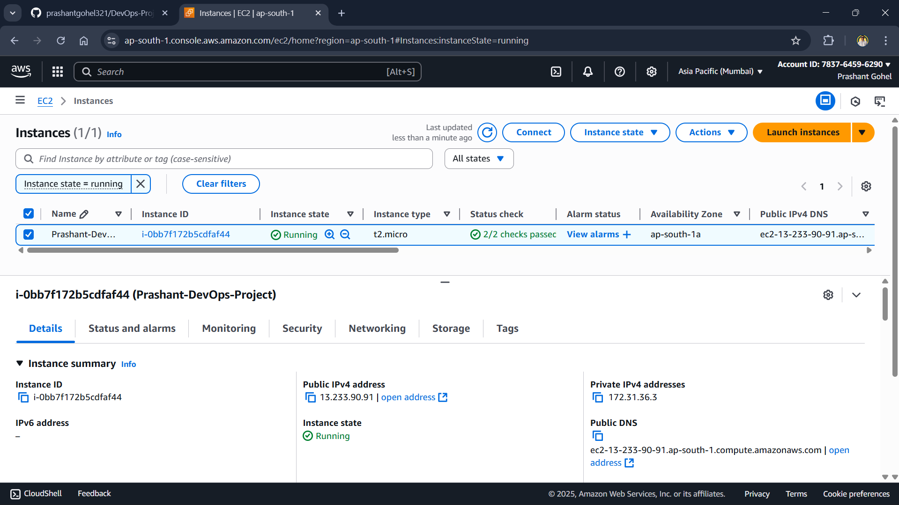
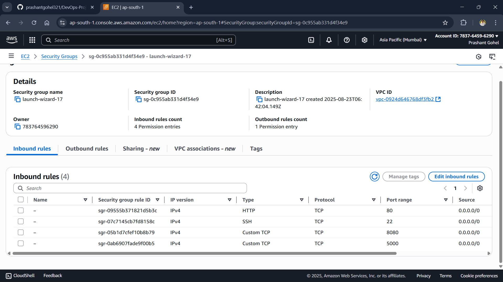
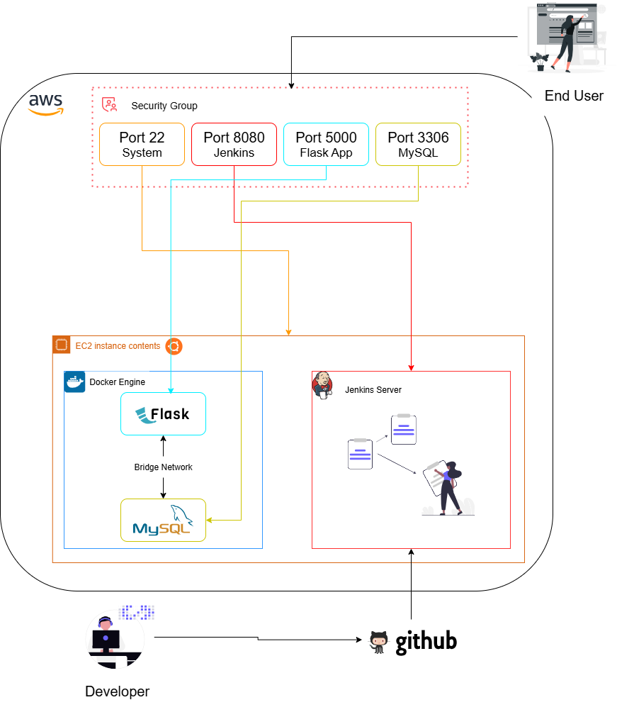
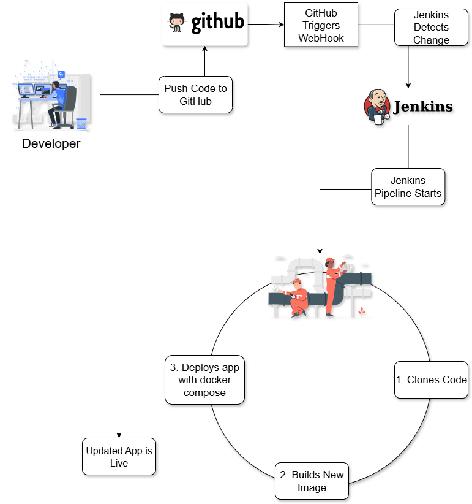

# Flask Two-Tier DevOps Platform

## Technical Project Report

Author: Kishore Billu

---

# 1. Introduction

This project demonstrates the implementation of a production-style two-tier web application using Flask and MySQL deployed on AWS.

The objective is to automate the complete software delivery lifecycle using Docker and Jenkins while following DevOps best practices.

---

# 2. Objectives

The primary objectives of this project are:

- Deploy a Flask application
- Configure a MySQL database
- Containerize the application
- Implement Docker Compose
- Configure Jenkins CI/CD
- Deploy automatically on AWS EC2
- Build a reusable DevOps deployment workflow

---

# 3. Technology Stack

| Category | Technology |
|----------|------------|
| Programming | Python |
| Framework | Flask |
| Database | MySQL |
| Container | Docker |
| Orchestration | Docker Compose |
| CI/CD | Jenkins |
| Cloud | AWS EC2 |
| Version Control | GitHub |
| OS | Ubuntu Linux |

---

# 4. System Architecture


  ```
+-----------------+      +----------------------+      +-----------------------------+
|   Developer     |----->|     GitHub Repo      |----->|        Jenkins Server       |
| (pushes code)   |      | (Source Code Mgmt)   |      |  (on AWS EC2)               |
+-----------------+      +----------------------+      |                             |
                                                       | 1. Clones Repo              |
                                                       | 2. Builds Docker Image      |
                                                       | 3. Runs Docker Compose      |
                                                       +--------------+--------------+
                                                                      |
                                                                      | Deploys
                                                                      v
                                                       +-----------------------------+
                                                       |      Application Server     |
                                                       |      (Same AWS EC2)         |
                                                       |                             |
                                                       | +-------------------------+ |
                                                       | | Docker Container: Flask | |
                                                       | +-------------------------+ |
                                                       |              |              |
                                                       |              v              |
                                                       | +-------------------------+ |
                                                       | | Docker Container: MySQL | |
                                                       | +-------------------------+ |
                                                       +-----------------------------+
```
---

# 5. Project Workflow

Developer

↓

GitHub Push

↓

Jenkins Trigger

↓

Clone Repository

↓

Build Docker Image

↓

Docker Compose Deployment

↓

Flask + MySQL Containers

↓

Application Available

---

# 6. AWS Infrastructure

## EC2

1.  **Launch EC2 Instance:**
    * Navigate to the AWS EC2 console.
    * Launch a new instance using the **Ubuntu 22.04 LTS** AMI.
    * Select the **t2.micro** instance type for free-tier eligibility.
    * Create and assign a new key pair for SSH access.



2.  **Configure Security Group:**
    * Create a security group with the following inbound rules:
        * **Type:** SSH, **Protocol:** TCP, **Port:** 22, **Source:** Your IP
        * **Type:** HTTP, **Protocol:** TCP, **Port:** 80, **Source:** Anywhere (0.0.0.0/0)
        * **Type:** Custom TCP, **Protocol:** TCP, **Port:** 5000 (for Flask), **Source:** Anywhere (0.0.0.0/0)
        * **Type:** Custom TCP, **Protocol:** TCP, **Port:** 8080 (for Jenkins), **Source:** Anywhere (0.0.0.0/0)



3.  **Connect to EC2 Instance:**
    * Use SSH to connect to the instance's public IP address.
    ```bash
    ssh -i /path/to/key.pem ubuntu@<ec2-public-ip>
1.  **Launch EC2 Instance:**
    * Navigate to the AWS EC2 console.
    * Launch a new instance using the **Ubuntu 22.04 LTS** AMI.
    * Select the **t2.micro** instance type for free-tier eligibility.
    * Create and assign a new key pair for SSH access.


2.  **Configure Security Group:**
    * Create a security group with the following inbound rules:
        * **Type:** SSH, **Protocol:** TCP, **Port:** 22, **Source:** Your IP
        * **Type:** HTTP, **Protocol:** TCP, **Port:** 80, **Source:** Anywhere (0.0.0.0/0)
        * **Type:** Custom TCP, **Protocol:** TCP, **Port:** 5000 (for Flask), **Source:** Anywhere (0.0.0.0/0)
        * **Type:** Custom TCP, **Protocol:** TCP, **Port:** 8080 (for Jenkins), **Source:** Anywhere (0.0.0.0/0)


3.  **Connect to EC2 Instance:**
    * Use SSH to connect to the instance's public IP address.
    ```bash
    ssh -i /path/to/key.pem ubuntu@<ec2-public-ip>
---

# 7. Docker Configuration

This file defines the environment for the Flask application container.
```dockerfile
# Use an official Python runtime as a parent image
FROM python:3.9-slim

# Set the working directory in the container
WORKDIR /app

# Install system dependencies required for mysqlclient
RUN apt-get update && apt-get install -y gcc default-libmysqlclient-dev pkg-config && \
    rm -rf /var/lib/apt/lists/*

# Copy the requirements file to leverage Docker cache
COPY requirements.txt .

# Install Python dependencies
RUN pip install --no-cache-dir -r requirements.txt

# Copy the rest of the application code
COPY . .

# Expose the port the app runs on
EXPOSE 5000

# Command to run the application
CMD ["python", "app.py"]
```

---

# 8. Docker Compose
This file defines and orchestrates the multi-container application (Flask and MySQL).
```yaml
version: "3.8"

services:
  mysql:
    container_name: mysql
    image: mysql
    environment:
      MYSQL_DATABASE: "devops"
      MYSQL_ROOT_PASSWORD: "root"
    ports:
      - "3306:3306"
    volumes:
      - mysql-data:/var/lib/mysql
    networks:
      - two-tier
    restart: always
    healthcheck:
      test: ["CMD", "mysqladmin", "ping", "-h", "localhost", "-uroot", "-proot"]
      interval: 10s
      timeout: 5s
      retries: 5
      start_period: 60s

  flask:
    build:
      context: .
    container_name: two-tier-app
    ports:
      - "5000:5000"
    environment:
      - MYSQL_HOST=mysql
      - MYSQL_USER=root
      - MYSQL_PASSWORD=root
      - MYSQL_DB=devops
    networks:
      - two-tier
    depends_on:
      - mysql
    restart: always
    healthcheck:
      test: ["CMD-SHELL", "curl -f http://localhost:5000/health || exit 1"]
      interval: 10s
      timeout: 5s
      retries: 5
      start_period: 60s

volumes:
  mysql-data:

networks:
  two-tier:
```

---

# 9. Jenkins Pipeline

This file contains the pipeline-as-code definition for Jenkins.
```groovy
pipeline {
    agent any
    stages {
        stage('Clone Code') {
            steps {
                // Replace with your GitHub repository URL
                git branch: 'main', url: '[https://github.com/your-username/your-repo.git](https://github.com/your-username/your-repo.git)'
            }
        }
        stage('Build Docker Image') {
            steps {
                sh 'docker build -t flask-app:latest .'
            }
        }
        stage('Deploy with Docker Compose') {
            steps {
                // Stop existing containers if they are running
                sh 'docker compose down || true'
                // Start the application, rebuilding the flask image
                sh 'docker compose up -d --build'
            }
        }
    }
}
```

---

# 10. Deployment Process

1. Push code to GitHub
2. Jenkins detects changes
3. Repository cloned
4. Docker image built
5. Existing containers stopped
6. New containers started
7. Application becomes available

---

# 11. Validation

Verify:

- Jenkins Build Success
- Docker Containers Running
- Flask Application Accessible
- MySQL Connectivity
- Application Logs

Commands

docker ps

docker logs

docker compose ps

systemctl status jenkins

---
# 12. Infrastructure Diagram**


# 13. Work flow Diagram**



# 14. Challenges

Examples:

- Docker networking
- Jenkins permissions
- MySQL startup timing
- Container communication
- Environment variables

---

# 15. Lessons Learned

This project provided practical experience in:

- Docker
- Jenkins
- AWS
- CI/CD
- Linux
- Production Deployment

---

# 16. Future Improvements

- GitHub Actions
- SonarQube
- Trivy
- Terraform
- Amazon ECR
- Amazon EKS
- Argo CD
- Prometheus
- Grafana
- Loki
- OpenTelemetry
- GitOps
- Blue/Green Deployment

---

# 17. Conclusion

This project demonstrates the end-to-end implementation of a containerized Flask application deployed on AWS using Docker and Jenkins.

It serves as the foundation for building a production-ready cloud-native DevOps platform that will continue to evolve with Infrastructure as Code, Kubernetes, GitOps, security, and observability.